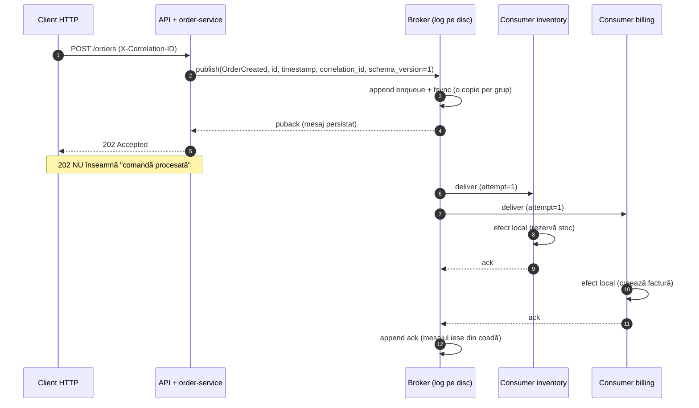
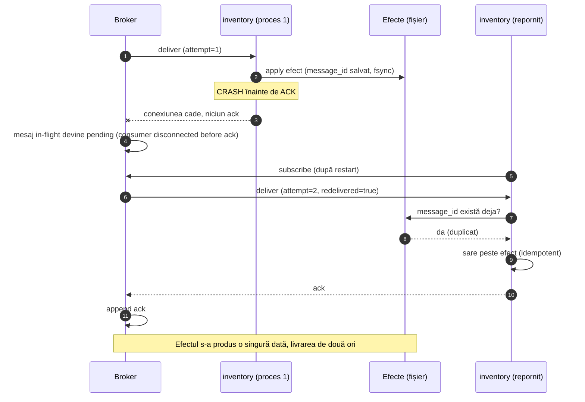
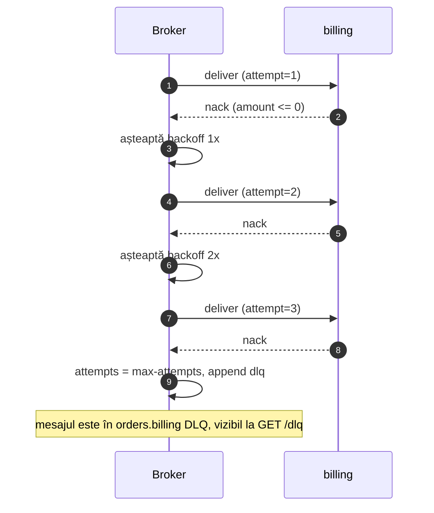

# Diagrame de secvență

Diagramele sunt scrise în Mermaid și se randează direct pe GitHub.

## 1. Fluxul normal: trimitere confirmată, apoi procesare confirmată

`puback` înseamnă doar că mesajul este pe disc în broker. `ack` înseamnă că procesarea s-a terminat. Sunt două confirmări diferite, pe două drumuri diferite.

## 2. Scenariul de eșec: consumatorul cade după efectul local, înainte de ACK

## 3. Retry și dead-letter queue

