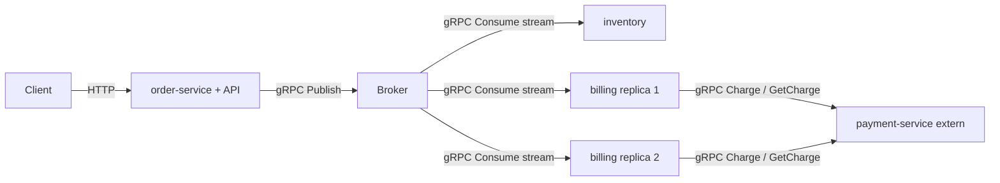

# PAD Lab 2: Message Broker cu gRPC

Același sistem ca în laboratorul 1 (producer, broker, consumatori, retry, DLQ, persistență), cu comunicarea mutată de pe socketuri JSON pe **gRPC + protobuf**, plus un **serviciu extern de plăți**. Accentul este pe versionare, compatibilitate, deadline, cancellation, idempotency și fallback, și pe scenariul critic: **răspunsul se pierde după efectuarea operației la distanță**.

Versiunea evaluată: tag-ul git **`lab2-v1.0`**.

## Arhitectura



Detalii: `docs/diagrams/architecture.md`; diagrame de secvență: `docs/diagrams/sequence.md`.

## Structura

```
contracts/              proto/{broker,orders,payment}/v1/*.proto, errors.md, versioning.md, http-api.md
src/
  api/                  API HTTP (POST /orders, GET /orders/{id}, /healthz, /readyz)
  order-service/        înregistrarea comenzilor, publicare idempotentă, outbox (fallback)
  integration-service/  broker/ (nucleu), server/ (adaptor gRPC), client/ (SDK),
                        envelope/ (mesaje, versiuni), rpcx/ (correlation ID, retry, config, fault injection)
  consumers/            inventory, billing (+ billing/billing: tratarea rezultatului ambiguu), common/
  payment-service/      serviciul extern: idempotency key, GetCharge, token, latență, fault injection
tests/                  unit, integration, contract, failure (+ testutil: pornește servere gRPC reale)
deployment/             Dockerfile (generează codul din .proto, construiește serviciile și testele)
docs/                   diagrams/, adr/, runbook/, failure-scenarios.md, delivery-guarantees.md, evidence/
scripts/                gen.sh, demo.sh (Linux/WSL), demo.ps1 (Windows, Docker)
docker-compose.yml, .env.example
```

Codul generat din `.proto` (`gen/`) nu este în repository (ADR 0003): îl generează Dockerfile-ul.

## Rulare (Windows, PowerShell, Docker Desktop)

Din folderul `Laborator2`:

```powershell
Copy-Item .env.example .env          # o singură dată; poți schimba PAYMENT_API_TOKEN
docker compose up --build -d         # broker, payment, order-service, inventory, 2 x billing
docker compose ps
```

Testele (unit, integrare, contract, eșec), cu detectorul de data race:

```powershell
docker compose run --rm tests
```

O comandă:

```powershell
Invoke-WebRequest -UseBasicParsing -Method Post http://localhost:8080/orders `
  -Headers @{ "Idempotency-Key" = "req-1"; "X-Correlation-ID" = "demo-1" } `
  -ContentType "application/json" -Body '{"customer_id":"c1","amount_cents":5000,"currency":"EUR"}'
Invoke-RestMethod http://localhost:8081/stats
docker compose logs | Select-String "demo-1"
```

Toate scenariile de eșec, pas cu pas, cu explicații: `scripts/demo.ps1`. Oprire: `docker compose down -v`.

## Rulare fără Docker (Linux, macOS, WSL)

```bash
go install google.golang.org/protobuf/cmd/protoc-gen-go@v1.35.1
go install google.golang.org/grpc/cmd/protoc-gen-go-grpc@v1.5.1
pip install grpcio-tools==1.66.2       # sau protoc pe PATH
./scripts/gen.sh                       # generează ./gen
go test -race ./...
./scripts/demo.sh                      # procese reale, toate scenariile, loguri în logs/evidence
```

## Conceptele laboratorului 2

| Concept | Realizare | Unde |
|---|---|---|
| RPC | gRPC: `Publish` unar, `Consume` flux bidirecțional (livrare push, fără polling) | `contracts/proto/broker/v1`, `src/integration-service/server` |
| Reprezentarea datelor | protobuf: plicul `Envelope`, payload `orders.v1.OrderCreated` | `contracts/proto` |
| Versionare | pachete `broker.v1`, `payment.v1`; `schema_version` per payload (1 și 2) | `contracts/versioning.md` |
| Compatibilitate | test „golden” al câmpurilor; payload nou citit de consumator vechi și invers | `tests/contract` |
| Deadline | fiecare apel are deadline per încercare, propagat de gRPC | `rpcx.Policy`, `docs/delivery-guarantees.md` |
| Cancellation | serverele verifică `ctx` înainte de commit; oprirea consumatorului anulează apelurile | `TestPublishDeadlineExpiresBeforeCommit_*`, `TestChargeDeadlineExpiresBeforeCommit_*` |
| Idempotency | `Idempotency-Key` HTTP, `message_id` derivat, cheia de plată `order:<id>` | ADR 0002 |
| Retry | limitat, backoff exponențial cu jitter, doar pe coduri tranzitorii | `rpcx/retry.go` |
| Fallback | outbox pentru comenzi când brokerul nu răspunde; `nack` și relivrare când plata nu răspunde | `order-service/service`, `consumers/billing/billing` |
| Scenariul critic | răspuns pierdut după commit, la plată și la publicare: reconciliere cu `GetCharge` și deduplicare | `docs/failure-scenarios.md` 1 și 2 |

## Livrabile

| Livrabil | Unde |
|---|---|
| contracte | `contracts/` |
| teste automate | `tests/` (`docker compose run --rm tests`) |
| diagrame | `docs/diagrams/` |
| ADR pentru decizia principală | `docs/adr/0001-grpc-protobuf.md` (plus 0002, 0003) |
| dovezile scenariului de eșec | `docs/failure-scenarios.md`, `docs/evidence/*.log` |
| instrucțiuni de reproducere | acest README, `scripts/demo.ps1`, `docs/runbook/runbook.md` |
| garanții și limite | `docs/delivery-guarantees.md` |

## Teste

```
tests/unit         plic, validare, id-uri stabile, backoff cu jitter, politica de retry, EffectStore
tests/contract     câmpurile proto (golden), compatibilitate v1/v2, semantica erorilor gRPC și HTTP
tests/integration  flux complet, grupuri, concurență, dinamic, load balancing, retry, DLQ, idempotență,
                   persistență, reconectare, end-to-end HTTP + broker + consumatori + payment
tests/failure      crash după efect, at-most-once, anulare, ack timeout, răspuns pierdut la Publish și
                   la Charge, deadline înainte de commit, disc defect, payment indisponibil, outbox
```
