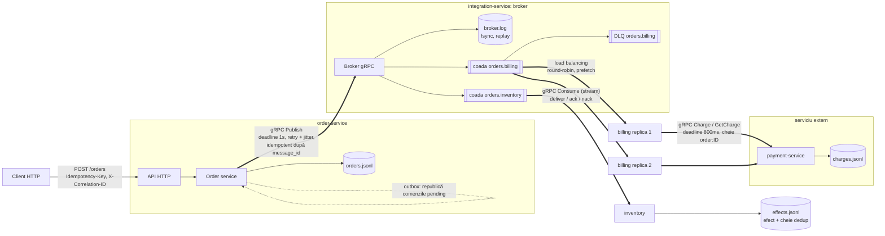

# Arhitectura

| Componentă | Director | Rol |
|---|---|---|
| API + order-service | `src/api`, `src/order-service` | validează cererea, salvează comanda, publică `OrderCreated`, outbox |
| Broker | `src/integration-service` | cozi durabile, livrare at-least-once, retry, DLQ, deduplicarea publicărilor |
| inventory | `src/consumers/inventory` | rezervă stocul (efect local idempotent) |
| billing | `src/consumers/billing` | încasează comanda la serviciul extern (idempotent, cu reconciliere) |
| payment-service | `src/payment-service` | serviciul extern: cheie de idempotență, `GetCharge`, token |

Toate apelurile dintre componente sunt gRPC cu contracte protobuf (`contracts/proto`). Correlation ID-ul trece prin headerul HTTP `X-Correlation-ID`, metadata gRPC `x-correlation-id`, câmpul `Envelope.correlation_id` și apare în fiecare linie de log.

Livrarea este push: brokerul trimite mesajul pe fluxul `Consume` imediat ce un consumator are capacitate, fără polling.
