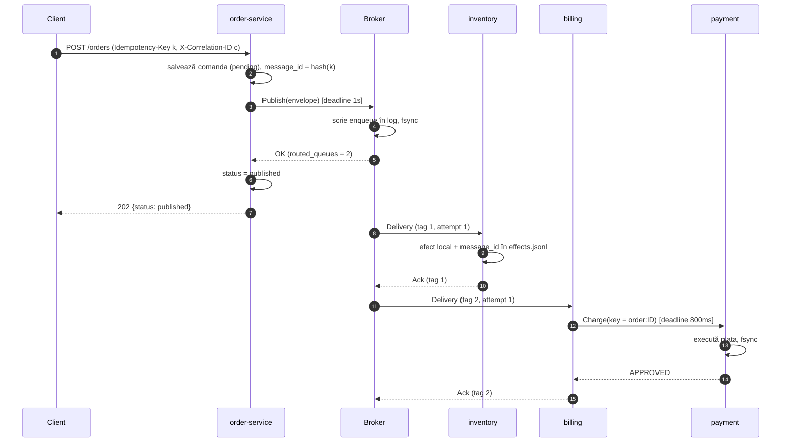
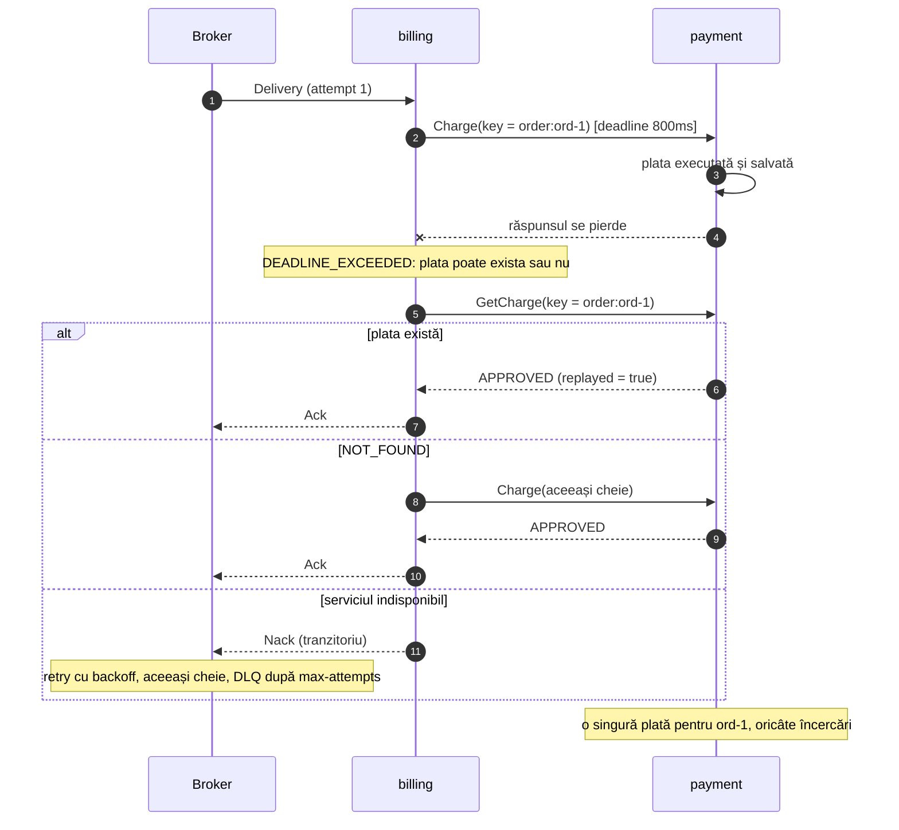
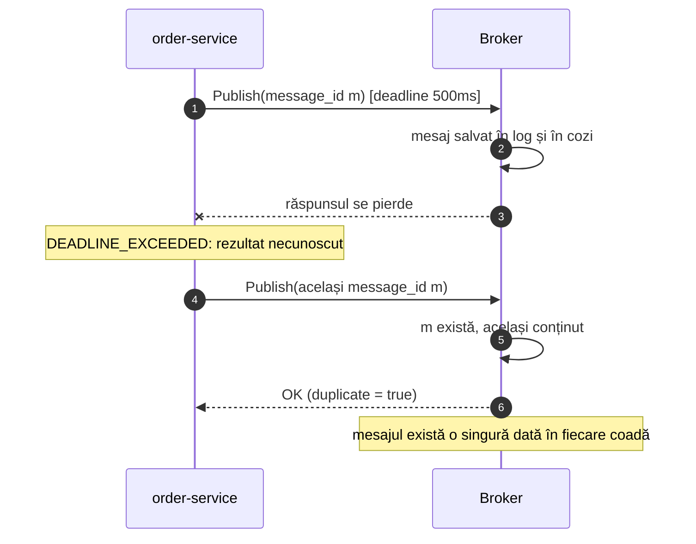
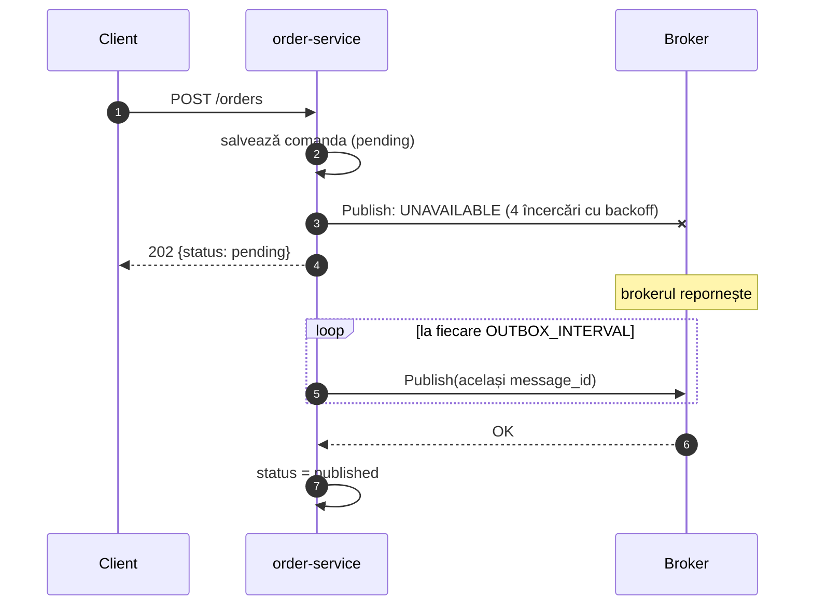
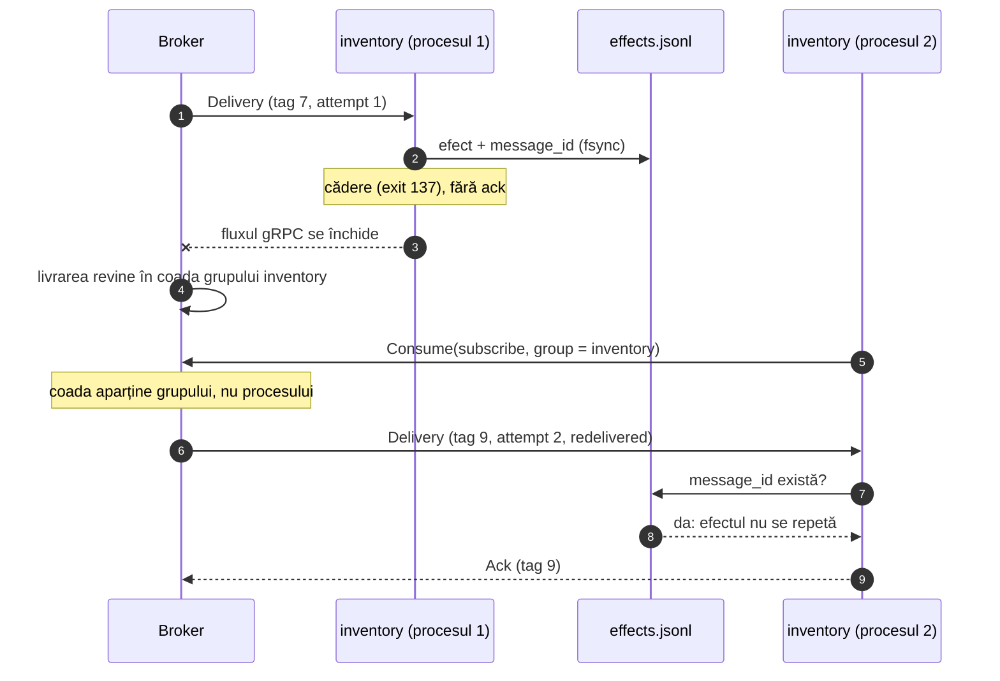

# Diagrame de secvență

## 1. Flux nominal

## 2. Scenariul critic: răspunsul se pierde după efectuarea plății

## 3. Răspunsul la Publish se pierde după commit

## 4. Brokerul indisponibil: fallback prin outbox

## 5. Consumatorul cade după efect, înainte de ACK

