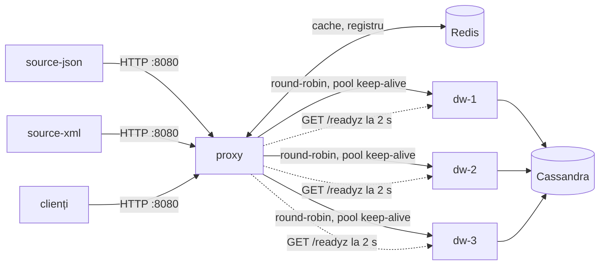

# PAD Lab 3: Web proxy (transparența în distribuire)

Un nod informativ **data warehouse (DW)** care servește angajați prin HTTP, în **JSON sau XML** la alegerea clientului, cu procesare concurentă a cererilor (etapa 1). În fața lui stă un **reverse proxy** prin care trece orice client (etapa 2):

- **smart proxy**: păstrează conexiunile clienților (keep-alive, limită per client) și ține în Redis registrul conexiunilor și al fiecărei cereri;
- **caching**: în Redis, cu invalidare corectă prin contoare de generație;
- **load balancing**: round-robin (sau least-connections) pe 3 replici DW, cu health check activ și circuit breaker.

Datele sunt într-o singură bază **Cassandra**, comună replicilor, iar cache-ul și registrul clienților în **Redis** (recomandările din enunț). Scris în Go, rulat cu Docker Compose.

Versiunea evaluată: tag-ul git **`lab3-v1.0`**.

## Arhitectura



Detalii: `docs/diagrams/architecture.md`; diagrame de secvență (MISS/HIT, cursa GET/PUT, PUT expirat, replică oprită, pull): `docs/diagrams/sequence.md`.

## Structura

```
contracts/      http-api.md, errors.md, versioning.md, employee.schema.json, employee.xsd
src/
  common/       logx (loguri, correlation ID, config), model (resursele), httpx (JSON/XML, negociere, client)
  datawarehouse/  dw/ (controller.go = Controller, service.go = Service, faults.go), store/ (Cassandra, Memory)
  proxy/        proxy/ (proxy, registry = smart proxy, admin), balancer/ (pool, health, breaker), cache/ (Redis)
  source-node/  nodul sursă: PUT + pull cu cursor
  client/       CLI
  loadgen/      generator de încărcare, rezultate în fișiere
tests/          unit, contract, integration, failure (+ testutil: pornește replici, Redis și proxy reale)
deployment/     Dockerfile (toate serviciile, testele și uneltele)
docs/           adr/ (0001-0006), diagrams/, runbook/, failure-scenarios.md, guarantees-and-limits.md,
                evidence/ (demo-*.log, results/*.json, summary.csv, summary.md)
scripts/        smoke (verificare rapidă), demo (scenariile de eșec), bench (măsurătorile): .sh și .ps1
docker-compose.yml, .env.example
```

## Rulare

Necesită doar **Docker Desktop** (Windows sau macOS), pornit. Cassandra și Redis nu se instalează: rulează în containere. Go nu e necesar.

### 1. Pornirea

Din folderul `Laborator3`, în PowerShell (Windows) sau Terminal (macOS):

```
docker compose up --build -d
```

Prima pornire durează 2–3 minute: se descarcă imaginile, se compilează serviciile, apoi Cassandra are nevoie de ~1 minut. Verificare:

```
docker compose ps
```

`cassandra`, `redis`, `dw-1`, `dw-2`, `dw-3` și `proxy` trebuie să fie `healthy`, `source-json` și `source-xml` `Up`. `schema` apare doar cu `docker compose ps -a`, ca `Exited (0)`: a creat tabelele și s-a oprit.

### 2. Verificarea rapidă (~20 s)

Windows:
```powershell
powershell -ExecutionPolicy Bypass -File scripts\smoke.ps1
```
macOS / Linux:
```bash
./scripts/smoke.sh
```

Face 14 verificări pe sistemul pornit: proxy și 3 replici în rotație, MISS apoi HIT, JSON și XML, rutele din enunț, round-robin pe dw-1/dw-2/dw-3, POST cu `Idempotency-Key` și preluarea lui de nodul sursă XML, conexiuni reutilizate, registrul din Redis. La final: `All 14 checks passed.`

(`-ExecutionPolicy Bypass` e necesar pentru că Windows blochează implicit scripturile `.ps1`; se aplică doar acestei comenzi.)

### 3. Încercat manual

Windows (în PowerShell scrie `curl.exe`, nu `curl`, care e alt program acolo):

```powershell
curl.exe -i http://localhost:8080/employees/emp-j-001                    # JSON; X-Cache: MISS
curl.exe -i http://localhost:8080/employees/emp-j-001                    # X-Cache: HIT
curl.exe -H "Accept: application/xml" http://localhost:8080/employees/emp-x-002
curl.exe "http://localhost:8080/employees/?offset=1&limit=4"
curl.exe -s http://127.0.0.1:8081/proxy/stats                           # cache, replici, conexiuni
docker compose logs -f proxy                                             # Ctrl+C pentru ieșire
```

macOS: aceleași comenzi, cu `curl` în loc de `curl.exe`. O modificare de la client (macOS):

```bash
curl -X POST localhost:8080/employees/emp-x-003 -H 'Idempotency-Key: k1' \
     -H 'Content-Type: application/json' -d '{"salary":45000}'
docker compose logs source-xml | grep change_applied                    # sursa a preluat-o (pull)
```

Clientul CLI din proiect (oriunde, rulează în Docker):
`docker compose run --rm tools go run ./src/client -url http://proxy:8080 -format xml get emp-x-001`

### 4. Scenariile de eșec și măsurătorile

| | Windows | macOS / Linux | Durată | Rezultat |
|---|---|---|---|---|
| scenariile de eșec | `powershell -ExecutionPolicy Bypass -File scripts\demo.ps1` | `./scripts/demo.sh` | ~2 min | `docs/evidence/demo-*.log` |
| măsurătorile | `powershell -ExecutionPolicy Bypass -File scripts\bench.ps1` | `./scripts/bench.sh` | ~4 min | `docs/evidence/results/` |

Ambele opresc și repornesc containere (dw-2, dw-3, redis) și rescriu fișierele de dovezi din repository. Scripturile PowerShell merg cu Windows PowerShell 5.1 (inclus în Windows) și cu PowerShell 7.

### 5. Testele automate

```
docker compose run --rm tests
```

Toate testele (unit, contract, integrare, eșec), cu detectorul de data race, plus testele pe Cassandra reală. Cu Go 1.24+ instalat: `go test -race ./...` (testele Cassandra se sar).

### 6. Oprirea

```
docker compose down       # oprește, păstrează datele
docker compose down -v    # oprește și șterge datele (Cassandra, Redis)
```

Probleme frecvente: `docs/runbook/runbook.md` (de exemplu, Cassandra fără suficientă memorie: în Docker Desktop → Settings → Resources, cel puțin 4 GB).

## Cerințele laboratorului

| Cerință | Realizare | Unde |
|---|---|---|
| DW comunică concurent prin HTTP | `net/http`: o goroutine per cerere (thread-per-request), `DW_MAX_INFLIGHT` | `src/datawarehouse`, `guarantees-and-limits.md` |
| GET date, PUT de la nodurile de stocare, POST modificări, pull `GET update/employees` | toate, inclusiv rutele exacte din enunț (`/employee/?id=`, `/employees/?offset=&limit=`, `/update/employees/`) | `contracts/http-api.md` |
| Clientul alege XML / JSON | `Accept` (cu `q`) sau `?format=`; și la cereri (`Content-Type`); `406`/`415` | `httpx.Negotiate`, `TestNegotiate`, `TestContract` |
| Colecții thread-safe / acces exclusiv | compare-and-set în Cassandra (LWT), `RWMutex` în stocarea de test, `atomic`/`Mutex` în proxy; testele cu `-race` | ADR 0001, `TestConcurrent*` |
| Controller | `dw/controller.go` (rute → Service → Data) | schema din enunț |
| Toate cererile prin proxy | porturile DW nu sunt publicate; sursele și clienții folosesc `:8080` | `docker-compose.yml` |
| Smart proxy (conexiunile clienților) | keep-alive gestionat, limită per client, registrul conexiunilor și cererilor în Redis, pool spre DW | ADR 0004, `demo-smart-proxy-001.log` |
| Caching | Redis, invalidare per angajat prin contoare de generație, `ETag`/`304`, `Cache-Control` | ADR 0002, `demo-race-001.log` |
| Load balancing | round-robin / least-conn peste replicile disponibile; health check activ + breaker | ADR 0003, `demo-health-001.log` |
| Recomandare: Cassandra | o bază comună, fără SyncService | ADR 0001 |
| Recomandare: Redis | cache + registrul conexiunilor | ADR 0002, 0004 |
| Opțional: PUSH | nu: pull cu cursor, argumentat | ADR 0005 |

## Cum sunt tratate remarcile primite pe o soluție anterioară

| Remarca | Ce s-a făcut | Dovada |
|---|---|---|
| Un GET început înainte de un PUT pune valoarea veche în cache; fără contor de generație; fără test | contoare de generație citite **înainte** de cererea la DW și salvate în intrare; intrarea veche nu se mai potrivește | `TestSlowGetStartedBeforePut_DoesNotCacheStaleValue`, `docs/evidence/demo-race-001.log` |
| Un PUT care expiră, dar a fost aplicat, nu invalidează | invalidare după scriere oricare ar fi rezultatul, plus una întârziată (`WRITE_GRACE`) la rezultat necunoscut | `TestPutTimesOutButApplied_*`, `TestWriteCommittedAfterProxyGaveUp_*`, `demo-put-timeout-001.log` |
| Un GET reîncercat care închiriază (are efecte) | niciun GET nu are efecte; pull-ul folosește cursor ținut de cititor, fără lease; retry doar pentru operații idempotente | ADR 0005, ADR 0006, `TestChangeFeedRetryHasNoSideEffect` |
| Fără health check activ; documentația spune altceva decât codul | `HealthChecker` interoghează `/readyz` la 2 s, plus breaker pasiv; funcționează fără trafic | `TestActiveHealthCheckWithoutTraffic`, `demo-health-001.log` |
| Fără ADR, fără tag, un singur commit | 6 ADR-uri cu alternative comparate; commit-uri pe etape; tag `lab3-v1.0` | `docs/adr/`, `git log` |
| Dovezi doar într-un tabel, fără loguri și fișiere, fără comparație cu / fără cache | loguri reale per scenariu, fișiere JSON/CSV per rulare, comparație cu / fără cache × sănătos / lent / oprit / Redis oprit | `docs/evidence/` |
| „Smart proxy” neargumentat; fără Redis; SQLite valabil doar pe același host | ADR 0004 compară interpretările; Redis pentru cache și registru; Cassandra prin rețea | ADR 0001, ADR 0004 |

## Rezultatul măsurătorilor (pe scurt)

| Scenariu | Fără cache | Cu cache |
|---|---|---|
| 3 replici sănătoase | 10 181 req/s, p50 1,48 ms | **13 232 req/s, p50 0,89 ms**, doar 14,7% din cereri ajung la DW |
| dw-2 lent (+200 ms), round-robin | 232 req/s | 2 899 req/s |
| dw-2 lent, least-connections | **7 930 req/s** | |
| dw-2 oprit în timpul rulării | 0 erori | 0 erori (9 retry) |
| Redis oprit | | 12 859 req/s, p99 2,7 ms, 0 erori |

Analiza completă: `docs/evidence/README.md`.

## Livrabile

| Livrabil | Unde |
|---|---|
| contracte | `contracts/` |
| teste automate | `tests/` (`docker compose run --rm tests`) |
| diagrame | `docs/diagrams/` |
| ADR-uri | `docs/adr/0001` – `0006` |
| dovezile scenariilor de eșec | `docs/failure-scenarios.md`, `docs/evidence/demo-*.log` |
| comparația cu / fără cache | `docs/evidence/README.md`, `docs/evidence/results/` |
| instrucțiuni de reproducere | acest README, `docs/runbook/runbook.md`, `scripts/` |
| garanții și limite | `docs/guarantees-and-limits.md` |

## Teste

```
tests/unit         negociere JSON/XML, encode/decode, validare, patch idempotent, versiuni concurente,
                   PUT no-op și If-Match, anulare înainte de commit, fereastra feed-ului, breaker,
                   round-robin (și fără o replică), least-conn, health check fall/rise
tests/contract     API-ul pe o replică și prin proxy: statusuri, câmpuri JSON (golden), XML, erori,
                   ETag/304, If-Match/412, Idempotency-Key, aliasurile din enunț, feed, antetele proxy-ului
tests/integration  distribuție round-robin, MISS/HIT, JSON/XML separat, invalidare per angajat și liste,
                   no-cache, feed necache-uit, surse JSON/XML + pull, pool spre DW, registrul clienților,
                   limita de conexiuni, least-conn cu replică lentă, scrieri concurente; Cassandra reală
tests/failure      cursa GET/PUT, PUT expirat dar aplicat, scriere confirmată după abandon, Redis oprit,
                   retry GET, POST cu/fără cheie, retry PUT no-op, retry feed, health check fără trafic,
                   replică oprită, breaker, 500 nu scoate replici, toate replicile căzute, cache cu replici căzute
```
