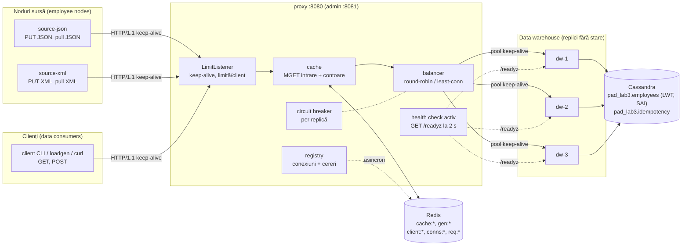

# Arhitectura

| Componentă | Cod | Rol |
|---|---|---|
| data warehouse | `src/datawarehouse` (`dw/controller.go` = Controller, `dw/service.go` = Service, `store/` = Data) | nodul informativ: JSON/XML, versiuni, compare-and-set, feed |
| proxy | `src/proxy` (`proxy/`, `balancer/`, `cache/`) | singurul punct de intrare: cache, load balancing, health check, breaker, retry, registrul clienților |
| nod sursă | `src/source-node` | trimite angajații cu PUT, preia modificările clienților prin pull |
| client | `src/client` | CLI pentru GET / list / PUT / POST / feed |
| loadgen | `src/loadgen` | încărcare concurentă, rezultate în fișiere |

Structura DW urmează schema din enunț: **container** (`net/http.Server`, o goroutine per cerere) → **Controller** (maparea rutelor HTTP pe operații, negocierea formatului) → **Service** (reguli, versiuni, idempotență) → **Data** (`store.Store`: Cassandra, sau `Memory` thread-safe în teste).

## Porturi

| Serviciu | Port | Publicat pe host |
|---|---|---|
| proxy (date) | 8080 | da: singura intrare pentru clienți |
| proxy (admin) | 8081 | doar `127.0.0.1` |
| dw-1..3 (date) | 8000 | **nu**: accesibile doar prin proxy |
| dw-1..3 (admin, injectarea eșecurilor) | 9000 | `127.0.0.1:9101..9103` |
| Redis, Cassandra | 6379, 9042 | nu |
