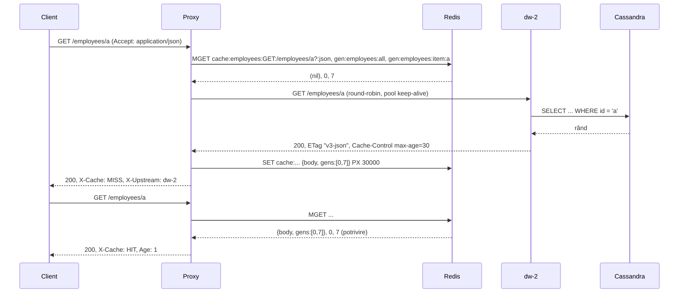
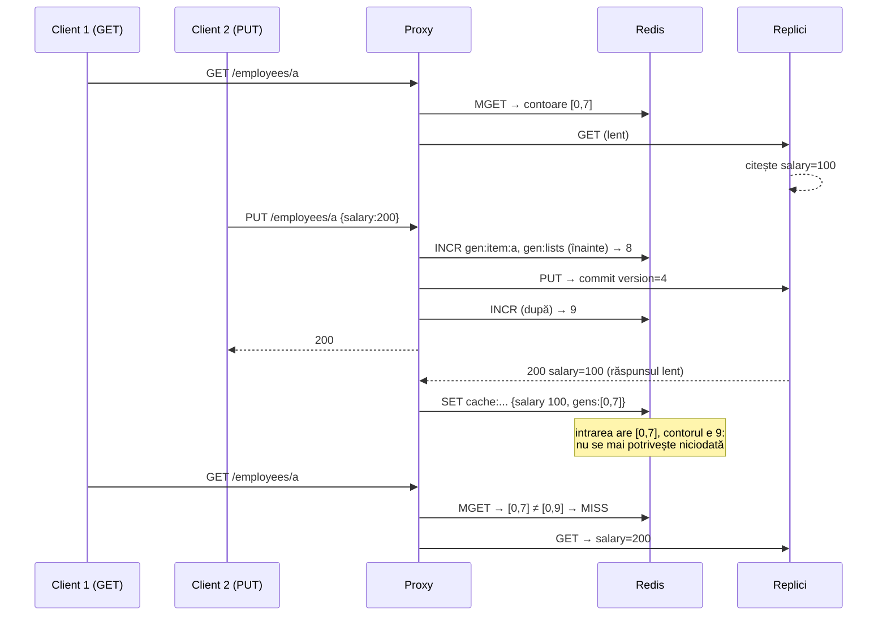
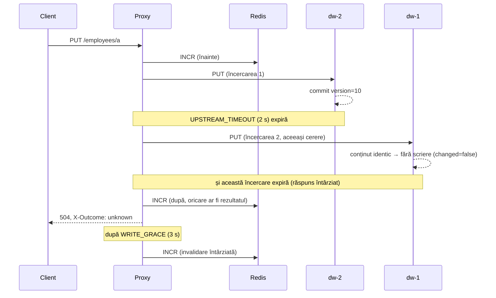
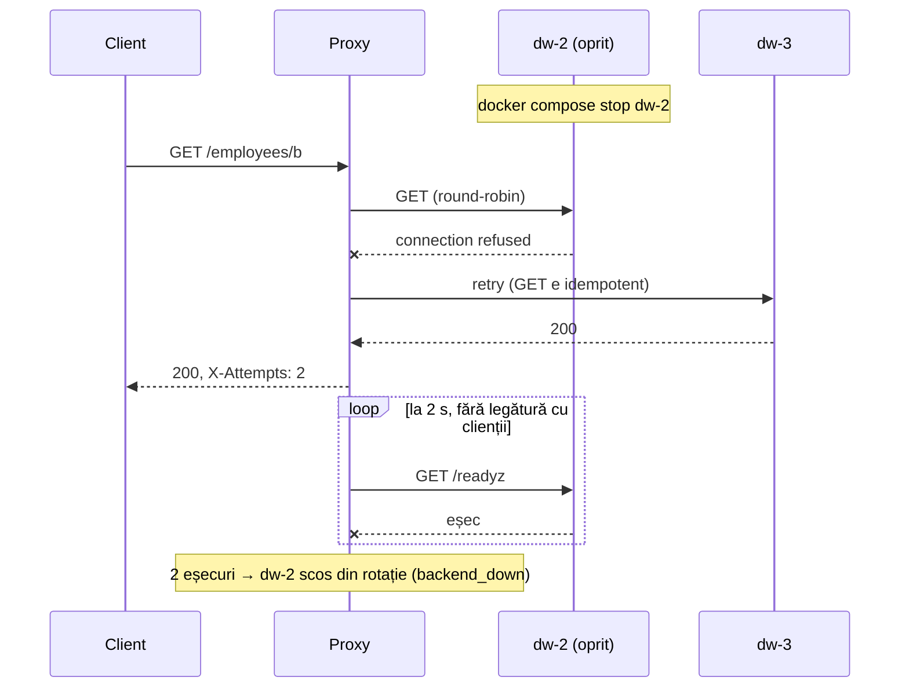
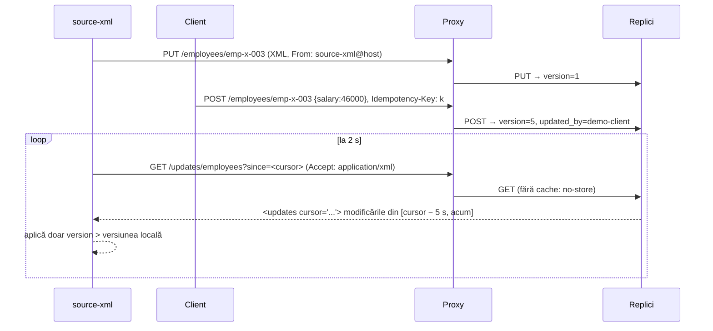

# Diagrame de secvență

## 1. GET: MISS, apoi HIT

## 2. Cursa GET lent / PUT (remarca 1)

## 3. PUT expirat, dar aplicat

## 4. Replică oprită: health check activ și retry

## 5. Pull de la nodul sursă

